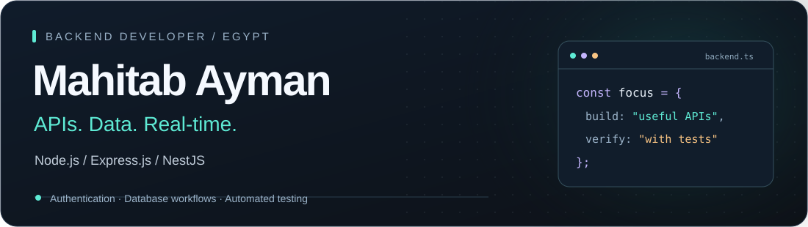
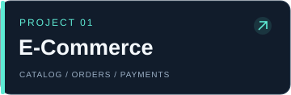
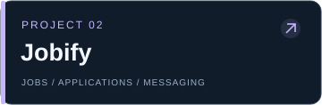
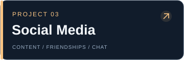

I build backend APIs for commerce, recruitment and social applications. 
<strong>TypeScript, MongoDB and real-time messaging — with clear documentation and automated tests.</strong>

&nbsp;

Based in Egypt · Open to junior backend developer opportunities

## Featured work

<table>
<tr>
<td width="33%" valign="top">

Commerce workflows with NestJS and MongoDB.

<ul><li>Transactional stock &amp; coupons</li><li>Stripe Checkout &amp; webhooks</li><li>Order and payment regression tests</li></ul>

<a href="https://github.com/Mahetab21/E-Commerce-App"><strong>Code ↗</strong></a> &nbsp;·&nbsp; <a href="https://github.com/Mahetab21/E-Commerce-App/blob/main/docs/API.md">API guide</a>

</td>
<td width="33%" valign="top">

Recruitment APIs for job seekers and employers.

<ul><li>Job search &amp; applications</li><li>Resume uploads &amp; access control</li><li>Persistent Socket.IO messaging</li></ul>

<a href="https://github.com/Mahetab21/jopify"><strong>Code ↗</strong></a> &nbsp;·&nbsp; <a href="https://github.com/Mahetab21/jopify/blob/main/docs/API.md">API guide</a>

</td>
<td width="33%" valign="top">

Social features with REST, GraphQL and real-time chat.

<ul><li>Public, private &amp; friends-only posts</li><li>Friend requests &amp; blocking</li><li>Authenticated direct &amp; group chat</li></ul>

<a href="https://github.com/Mahetab21/social-media-app"><strong>Code ↗</strong></a> &nbsp;·&nbsp; <a href="https://github.com/Mahetab21/social-media-app/blob/main/docs/API.md">API guide</a>

</td>
</tr>
</table>

<a href="https://github.com/Mahetab21?tab=repositories">Explore all repositories →</a>

## My toolkit

| Focus | Tools & practices |
| --- | --- |
| APIs & authentication | REST, JWT, Google sign-in, bcrypt, Zod, class-validator |
| Data & integrations | Mongoose, MySQL, Stripe Checkout, Nodemailer |
| Testing & delivery | Jest, Supertest, Node.js test runner, GitHub Actions |
| Documentation & workflow | OpenAPI/Swagger, Postman, Git |

## A little about me

- **Computer Science** · Higher Technological Institute, 2022–2026.
- **Backend training** · Route IT Training Center, February–September 2025; Node.js Diploma, October 2025.
- **Community** · Problem Solving Mentor at ICPC HTI, 2023–2024 — practice sessions, mentoring and code reviews.

---

<strong>Have a backend role or a project in mind?</strong> 
<a href="mailto:mahitabayman80@gmail.com">mahitabayman80@gmail.com</a> &nbsp;·&nbsp; <a href="https://www.linkedin.com/in/mahitab-ayman-6848b0383/">LinkedIn</a>

